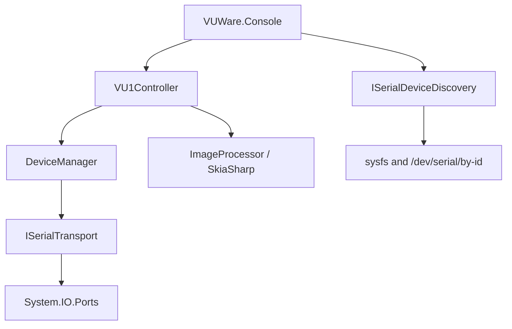

# VUWare Linux Port: Technology Evaluation and Implementation Plan

## Decision summary

The Linux implementation will use C# and .NET 10 LTS. The first milestone consists of independent `VUWare.Lib` and `VUWare.Console` projects under this directory, plus automated tests. It provides VU1 hub discovery and dial control; hardware sensor monitoring is deliberately deferred.

| Area | Selected technology |
|---|---|
| Runtime | .NET 10 LTS / C# |
| Serial I/O | `System.IO.Ports` |
| Device discovery | `/dev/serial/by-id` and Linux sysfs |
| Image processing | SkiaSharp |
| Configuration | `System.Text.Json` when configuration is introduced |
| Tests | xUnit |
| Initial targets | `linux-x64`, `linux-arm64` |

.NET 10 was selected because this is a new port and .NET 8 reaches end of support in November 2026. Keeping C# preserves the existing protocol and device-management investment. A Rust, C++, or Python rewrite would increase implementation and verification risk without improving the first milestone.

## Existing-code assessment

The protocol encoder, response parser, dial state, device manager, controller, and sensor contracts are platform-neutral. The platform-sensitive areas are:

1. Serial-device discovery and Linux permissions.
2. Image decoding, because `System.Drawing.Common` is Windows-only on current .NET.
3. Sensor acquisition, because HWInfo64 is Windows-only.
4. Console messages and diagnostics that currently assume COM ports and Device Manager.

The Linux projects are independent copies. The Windows projects remain unchanged during this milestone. A shared portable core can be considered after Linux behavior has been validated against real hardware.

## Serial stack

`System.IO.Ports` remains the transport library. The hub protocol uses 115200 baud, 8 data bits, no parity, one stop bit, no handshake, and CRLF-terminated ASCII messages.

Discovery is separate from transport:

- Prefer stable paths below `/dev/serial/by-id`.
- Inspect `/sys/class/tty` ancestry for USB vendor `0403` and product `6015`.
- Permit an explicit `/dev/...` path.
- Probe candidates with the harmless bus-rescan command.
- Never fall back to an arbitrary first serial port.

Expected failures—no matching device, permission denied, device busy, timeout, and protocol mismatch—must be distinguishable in diagnostics. Packaging may later install a udev rule, but the rule must not be chosen before target-distribution ownership policies have been tested.

## Image stack

The wire format remains 200×144 pixels, one bit per pixel, vertically packed in groups of eight with the top pixel in the most-significant bit. A complete image is exactly 3,600 bytes and is transferred in chunks of at most 1,000 bytes.

SkiaSharp replaces only file decoding, proportional resizing, and white letterboxing. Pure grayscale packing and chunking remain dependency-free and directly testable.

`System.Drawing.Common` is rejected because it is Windows-only. ImageSharp was considered, but its current direct-dependency licensing and build-key requirements add avoidable friction for an open-source contributor workflow. SkiaSharp is MIT licensed, although its native Linux assets increase deployment size.

## Sensor strategy (deferred)

The existing `ISensorProvider` model is suitable for Linux, but HWInfo64 itself is not portable. A later `VUWare.Sensors.Linux` project should begin with the Linux hwmon ABI and may add a `libsensors` provider for configured labels and motherboard-specific scaling.

Potential providers:

- `/sys/class/hwmon`: dependency-free and efficient, but requires unit conversion and stable identity construction.
- `libsensors`: better configured labels and scaling, but requires native interop and a distribution dependency.
- `/proc/stat`, `/proc/meminfo`, and `/proc/diskstats`: system metrics rather than hardware sensors.
- Vendor APIs such as NVML: optional specialized coverage.

Stable sensor IDs must not depend on volatile names such as `hwmon0`.

## Console strategy

The first console preserves the existing interactive REPL for rapid parity. It includes connection, initialization, dial listing and inspection, position, backlight, image upload, and tests. Linux-native `sensors` and `monitor` commands expose the four prototype measurements without HWInfo64.

Two Linux diagnostics are added:

- `devices`: show matching serial candidates and access state.
- `doctor`: show OS, architecture, runtime, matching hardware, stable paths, and actionable permission guidance.

A noninteractive `System.CommandLine` interface, dependency-injection container, and richer terminal UI remain possible future additions; none are needed to validate the core port.

## Architecture

Transport and discovery have interfaces so protocol/device tests can use deterministic fakes and do not require USB hardware.

## Milestones

### 1. Foundation

- Create the .NET 10 solution, library, console, and test projects.
- Add this decision record and Linux build/run guidance.

### 2. Library

- Port protocol, state, and device behavior.
- Introduce injectable serial transport.
- Implement Linux discovery without arbitrary-port fallback.
- Replace image loading with SkiaSharp.
- Make cancellation and teardown bounded.

### 3. Console

- Port the dial-control REPL.
- Remove HWInfo64 coupling and Windows terminology.
- Add `devices` and `doctor` diagnostics.

### 4. Linux measurements

- Add a provider compatible with the portable Windows sensor contracts.
- Calculate aggregate CPU load from `/proc/stat` deltas.
- Read AMD CPU temperature from `k10temp` hwmon channels.
- Read primary AMD GPU load and temperature from `amdgpu` sysfs/hwmon.
- Sample once per second and map the four stable metric keys to dials through the console.
- Treat NVIDIA/NVML, Intel GPU load, multiple GPUs, and persistent mappings as later work.

### 5. Verification

- Test command encoding, response validation, image packing/chunking, discovery, cancellation, and fake transport sequences.
- Build and test the solution in Release mode.
- Publish `linux-x64` and `linux-arm64` outputs.
- Hardware-test discovery, initialization, position, color, image transfer, unplug/reconnect, denied access, timeout, and Ctrl+C behavior.

## Deferred scope

- NVIDIA/NVML, Intel GPU load, and multi-GPU sensor support.
- Persistent dial-to-sensor mappings and startup monitoring.
- Desktop UI.
- systemd service mode.
- Hot-plug event monitoring through libudev.
- Debian/RPM/AppImage/Flatpak/Snap packaging.
- Installer-managed udev rules.
- Changes to the Windows projects.

## Principal risks

1. Serial permissions and distribution-specific group policies.
2. Device-path churn unless stable links and USB metadata are used.
3. Cancellation behavior of serial streams on different kernels and USB drivers.
4. Native Skia asset coverage across distributions and architectures.
5. Stable and meaningful Linux sensor identity in the later sensor milestone.

These risks are contained behind transport, discovery, image, and sensor-provider boundaries.